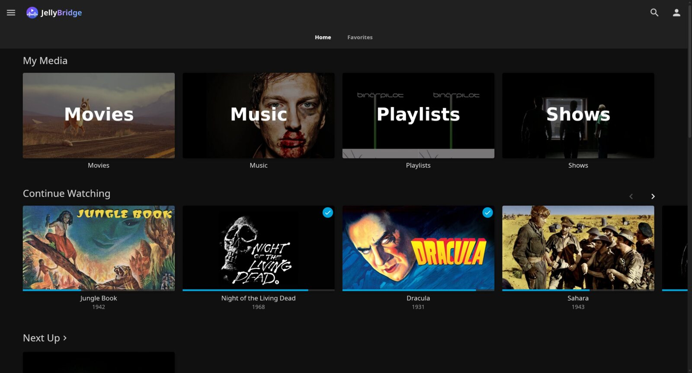
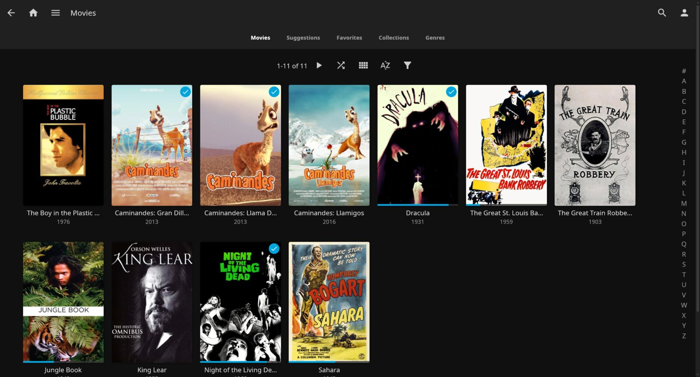
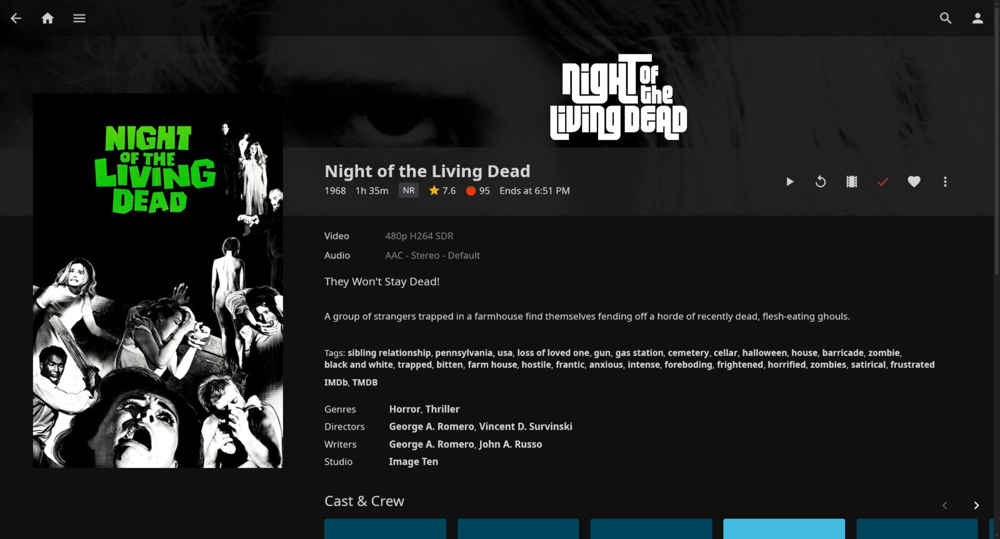

<p align="center"></p>

<p align="center">
  A fast, native desktop client for <a href="https://jellyfin.org">Jellyfin</a>, with a built-in mpv player.<br>
  Linux, Windows and macOS. Free software under GPL-3.0.<br>
  <a href="https://jellybridge.oddbench.co">jellybridge.oddbench.co</a>
</p>

<p align="center"></p>

JellyBridge looks and works like Jellyfin's own web app, but runs as a real
desktop program instead of a browser tab. It shows your Home screen about a
tenth of a second after launch, uses around 120 MB of memory while you browse,
and plays your files as they are, through [mpv](https://mpv.io), so the server
never has to transcode.

## Why JellyBridge

- **Fast.** Scrolling keeps up with 240 Hz displays, and an idle window
  draws nothing and uses next to no CPU. The numbers, and how they were
  measured, are in [docs/PERFORMANCE.md](docs/PERFORMANCE.md).
- **Plays your files directly.** mpv decodes H.264, HEVC, AV1, VP9, 10-bit
  and HDR video from the original file, with hardware decoding where your GPU
  supports it. Your server's CPU stays idle and the picture is never
  re-encoded.
- **Nothing extra to install.** The packages bring their own player and
  codecs; you do not need to install mpv or FFmpeg.
- **Familiar.** Pages, cards, menus and settings follow jellyfin-web, so
  everything is where you expect it.
- **Private.** It talks only to your server. Your access token never reaches
  the player: mpv streams through a local proxy that adds it.

## Screenshots

| Library | Item page | Player |
| --- | --- | --- |
|  |  |  |

Screenshots use Jellyfin's [public demo server](https://demo.jellyfin.org).

## Features

- **Home** with your libraries, Continue Watching, Next Up and the latest
  additions, arranged by your Jellyfin Home settings.
- **Libraries** as poster grids with sorting, filters, an A–Z jump bar and
  Suggestions, Favorites, Collections and Genres tabs.
- **Search** across the whole server, with results as you type.
- **Item pages** for films, series, seasons, episodes and people: backdrop,
  logo, ratings, media info, cast and crew, trailers and similar titles.
- **Player** with resume, audio and subtitle tracks (embedded and external),
  chapters, playback speed, previous and next episode, and skip buttons for
  intros, recaps and outros where the server has detected them. While a
  video plays your computer stays awake: no screen lock, blanking or sleep
  until you pause.
- **Progress that syncs**: positions, watched state and favorites are saved
  on the server, so you can continue on any other device.
- **Playlists and collections**: add items to them from any item's menu.
- **Sign-in** with a password or Quick Connect, and you stay signed in.
- **Settings** for profile, display, Home sections, playback and subtitle
  appearance, as in jellyfin-web.

JellyBridge is built for video. It does not (yet) offer transcoding for files
mpv cannot play, Live TV, SyncPlay, casting, offline sync or server
administration; music and books can be browsed but have no dedicated player.

## Install

Download the file for your system from the
[Releases page](https://github.com/oddbench-co/jellybridge/releases). Every
package includes everything playback needs.

| System | File | How to install |
| --- | --- | --- |
| Ubuntu 22.04+, Debian 12+, Linux Mint, Pop!_OS, elementary OS | `jellybridge_<version>_amd64.deb` | Open it with the Software app, or `sudo apt install ./jellybridge_*_amd64.deb` |
| Fedora, openSUSE | `jellybridge-<version>-1.x86_64.rpm` | `sudo dnf install ./jellybridge-*.rpm` or `sudo zypper install ./jellybridge-*.rpm` |
| Arch, Manjaro, EndeavourOS | `jellybridge-<version>-1-x86_64.pkg.tar.zst` | `sudo pacman -U jellybridge-*.pkg.tar.zst` (uses Arch's own mpv) |
| Any other Linux (glibc 2.35+) | `JellyBridge-<version>-x86_64.AppImage` | Make it executable and run it |
| Linux, without root | `jellybridge-<version>-x86_64.tar.gz` | Unpack and run `./install.sh` (installs to `~/.local`) |
| Windows 10 and 11 | `JellyBridge-<version>-setup.exe` | Run it. Installs for your user only, no administrator prompt |
| Windows, no install | `JellyBridge-<version>-portable.zip` | Unpack anywhere and run `jellybridge.exe` |
| macOS 14+ on Apple Silicon | `JellyBridge-<version>-macos-arm64.dmg` | Open it and drag JellyBridge to Applications |
| macOS 15+ on Intel | `JellyBridge-<version>-macos-x86_64.dmg` | Open it and drag JellyBridge to Applications |

Each package was installed and tested on the systems listed in
[docs/rust-port/platform-matrix.md](docs/rust-port/platform-matrix.md):
Ubuntu, Debian, Fedora, openSUSE, Mint, Pop!_OS, elementary, Manjaro,
EndeavourOS, Windows 10 and Windows 11. The macOS builds are signed and
notarized by Apple. JellyBridge needs a graphics driver with OpenGL 2.0 or
newer, which every current driver provides.

Until the first release is published, build the packages yourself (see
[Building packages](#building-packages)).

## Getting started

1. Start JellyBridge from your app menu.
2. Enter your server's address, for example `192.168.1.10:8096` or
   `https://jellyfin.example.com`.
3. Sign in with your Jellyfin username and password, or use Quick Connect
   from a device where you are already signed in.

Tested with Jellyfin 10.11 and 12.

## Keyboard shortcuts in the player

| Key | Action |
| --- | --- |
| `Space`, `K` | Play or pause |
| `←` / `→` | Back 10 s / forward 30 s (with `Shift`: 5 s) |
| `J` / `L` | Back 10 s / forward 30 s |
| `0`–`9` | Jump to 0 %–90 % of the video |
| `Home` / `End` | Jump to the start / end |
| `↑` / `↓` | Volume up / down |
| `M` | Mute |
| `F` | Fullscreen |
| `A` / `C` | Next audio track / next subtitle track |
| `<` / `>` | Slower / faster |
| `Page Up` / `Page Down` | Next / previous chapter |
| `Shift+N` / `Shift+P` | Next / previous episode |
| `Esc` | Leave fullscreen, or leave the player |
| `Q` | Leave the player |

## Troubleshooting

**A video will not play, or the picture is black.** JellyBridge plays the
original file and never asks the server to transcode. mpv falls back to
software decoding for formats your GPU cannot decode (10-bit H.264, 4:2:2
chroma and similar). To rule out hardware decoding, start it with
`JELLYBRIDGE_HWDEC=no jellybridge`; `JELLYBRIDGE_HWDEC=auto` allows modes the
default (`auto-safe`) leaves out. The player's status line shows which decoder
is in use.

**JellyBridge asks me to sign in again.** The server no longer accepts the
saved sign-in, usually because it was signed out from the server's dashboard
or the password changed. Sign in again.

**It will not start.** If your graphics driver lacks OpenGL 2.0, JellyBridge
shows a message saying so; install or update the driver. Started from a
terminal, it prints the reason there too.

## Your data

| What | Linux | Windows |
| --- | --- | --- |
| Sign-in (server address, access token, user id) | `~/.config/jellybridge/session.json` | `%APPDATA%\JellyBridge\session.json` |
| Settings | `~/.config/jellybridge/settings.json` | `%APPDATA%\JellyBridge\settings.json` |
| Artwork cache | `~/.cache/jellybridge/` | `%LOCALAPPDATA%\JellyBridge\` |

On macOS the files are in `~/.config/jellybridge/` and
`~/.cache/jellybridge/`, as on Linux.

Uninstalling leaves these in place, so a reinstall keeps you signed in. Sign
Out in the app removes the sign-in. The session file holds an access token to
your server: keep it private and never commit it.

## Building from source

You need [rustup](https://rustup.rs) (the toolchain version is pinned by
`rust-toolchain.toml`) and, to play media, libmpv from your system's mpv
package (`sudo apt install libmpv-dev`, `sudo pacman -S mpv`,
`brew install mpv`). Browsing works without libmpv; it is loaded on the first
play.

Run every cargo command through `scripts/cargo-env.sh`, which pins the
toolchain and points the build at libmpv:

```bash
scripts/cargo-env.sh run --release                                  # run the app
scripts/cargo-env.sh test --locked                                  # tests
scripts/cargo-env.sh clippy --all-targets --locked -- -D warnings   # lint
scripts/cargo-env.sh fmt --all                                      # format
```

### Building packages

The release packages are built in throwaway containers (podman or docker), so
nothing is installed on your machine:

```bash
scripts/build-linux.sh      # portable bundle on an Ubuntu 22.04 base (glibc 2.35), with libmpv and codecs
scripts/package-linux.sh    # .deb, .rpm, AppImage, tarball and Arch package -> target/linux/dist/
scripts/build-windows.sh    # setup.exe and portable zip -> target/windows/dist/
scripts/package-macos.sh    # on a Mac: .app and .dmg for its CPU -> target/macos/dist/
```

Releases are built by GitHub Actions when a version tag is pushed; see
[docs/RELEASING.md](docs/RELEASING.md).

The first `build-linux.sh` compiles mpv, FFmpeg, dav1d, libass, libplacebo
and libva from source (about 15 minutes, cached afterwards). The VM test
harness that checks the packages on each distribution is described in
[docs/rust-port/platform-matrix.md](docs/rust-port/platform-matrix.md).

## How it is built

JellyBridge is written in Rust. The interface is drawn with
[egui](https://github.com/emilk/egui) on OpenGL, and libmpv renders video into
the same window. Network and disk work runs on a tokio runtime, off the
thread that draws, so the window never waits on the server.

```text
rust/app/src
├── main.rs        startup and wiring
├── api.rs, api/   Jellyfin HTTP client
├── features/      what the app does: sign-in, pages, playback, settings
├── services/      artwork cache, session storage, mpv, the playback proxy
└── ui/            everything on screen (the only code that uses egui)
```

More detail: [docs/PERFORMANCE.md](docs/PERFORMANCE.md) (what was measured
and optimized),
[docs/jellyfin-web-reference.md](docs/jellyfin-web-reference.md) (how the
interface follows jellyfin-web) and [docs/rust-port/](docs/rust-port/)
(packaging, native dependencies, test matrix).

## Website

The project site at [jellybridge.oddbench.co](https://jellybridge.oddbench.co) is a separate Rust
crate in [web/](web/), with its own tests and deploy; see [web/README.md](web/README.md).

## Contributing

Bug reports and pull requests are welcome. Before opening a pull request, run
the tests, clippy and rustfmt as above; [AGENTS.md](AGENTS.md) describes the
code layout, conventions and test scripts in more depth. Changes that touch
startup, scrolling or playback should come with before and after numbers from
`JELLYBRIDGE_MEASURE` (see [docs/PERFORMANCE.md](docs/PERFORMANCE.md)).

## License

JellyBridge is free software: you can redistribute it and modify it under the
terms of the [GNU General Public License v3.0](LICENSE) or later. Bundled
fonts, icons and media libraries keep their own licences, listed in
[THIRD-PARTY-NOTICES.md](THIRD-PARTY-NOTICES.md).

JellyBridge is an independent project, not affiliated with or endorsed by the
Jellyfin project. Jellyfin is a trademark of the Jellyfin project.
